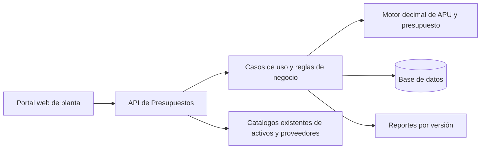

# Guía técnica de implementación de Presupuestos LULO Web

Esta guía desarrolla la **etapa 1 de 3**. El [índice de implementación](INDICE_IMPLEMENTACION_LULO_WEB.md) reúne los documentos de [Control de obra](ETAPA_02_CONTROL_DE_OBRA.md) y [Reconsideraciones y Cierre](ETAPA_03_RECONSIDERACIONES_Y_CIERRE.md).

**Propósito.** Construir un módulo web para estimar el costo de una obra, emitir un presupuesto trazable y, en una segunda etapa, controlar cantidades ejecutadas, variaciones y valuaciones hasta el cierre.

**Resultado esperado.** Un usuario prepara una obra, selecciona insumos o partidas reutilizables, calcula precios unitarios, revisa y emite un presupuesto por capítulos. El equipo puede reconstruir cada monto a partir de las cantidades, precios y reglas utilizados en la versión emitida. Cuando se incorpora el control de obra, la versión emitida sirve como línea base para medir y valorar la ejecución.

## 1. Punto de partida y decisiones

| Archivo del proyecto | Uso |
| --- | --- |
| [Especificación funcional](ESPECIFICACION_MVP.md) | Casos de uso, maestros, referencia al manual y observaciones sobre la base de LuloWin. |
| [Motor de referencia](motor_presupuesto.py) | Fórmulas del MVP y contrato inicial de cálculo. |
| [Presupuesto de ejemplo](ejemplo_presupuesto.json) | Datos de prueba y comparación de resultados. |

La guía propone **PostgreSQL, un backend Python con API HTTP y un frontend TypeScript integrado al portal existente**. Si el portal ya tiene otro backend, usar el mismo contrato y reproducir el motor con una biblioteca decimal del servidor. Reutilizar identidad, permisos, navegación y diseño del portal. Confirmar el stack efectivo antes de crear repositorios o instalar dependencias.

LuloWin aporta el comportamiento de referencia para obras, maestros, APU, presupuestos, mediciones y valuaciones. Esta guía define las reglas operativas de una implementación independiente. La equivalencia exacta de FCAS, indirectos, impuestos, redondeo y reconsideraciones con LuloWin 2018 requiere presupuestos de referencia aprobados para comparación. En el MVP se aplica el perfil de cálculo documentado en esta guía.

| Entrega | Objetivo operativo | Cierre verificable |
| --- | --- | --- |
| MVP | Estimar, revisar y emitir presupuestos. | Emitir y reproducir un presupuesto con capítulos, APU, precio manual, precio asumido y reporte. |
| Control de obra | Medir cantidades y valorar ejecución contra el contrato. | Emitir una valuación por período con acumulados, ajustes y saldo conciliados. |
| Cierre | Consolidar la ejecución contractual y sus ajustes. | Comparar presupuesto original, cambios aprobados y ejecución, y emitir el cuadro de cierre. |

## 2. Arquitectura y responsabilidades



- **Dominio.** Define entidades, reglas y transiciones. El cálculo es una función determinista con entradas completas. Devuelve desglose y errores de validación.
- **Aplicación.** Ejecuta casos de uso, comprueba permisos y estado, resuelve precios vigentes y coordina transacciones. Construye las entradas del motor.
- **Persistencia.** Guarda maestros, revisiones, copias del presupuesto, auditoría e importaciones. Usa claves foráneas, índices y restricciones para mantener consistencia.
- **API.** Valida formatos, recibe solicitudes, traduce errores a respuestas estables y entrega las representaciones que necesita la interfaz.
- **Frontend.** Edita borradores y presenta validaciones, desgloses y reportes. Los montos oficiales provienen del backend.
- **Integraciones.** Consultan los maestros existentes mediante identificadores estables. El código de etapa y el TAG sirven para búsqueda y presentación.

Organización sugerida del código del módulo.

```text
backend/presupuestos/
  dominio/           entidades, cálculo, transiciones
  aplicacion/       maestros, presupuestos, revisión, emisión, recálculo
  infraestructura/  repositorios, importaciones, reportes, auditoría
  api/              rutas, validadores y contratos
frontend/presupuestos/
  obras/            listado y ficha
  editor/           capítulos, partidas, APU, recálculo
  maestros/         catálogos, precios e importación
  revision/         envío, devolución, emisión y consulta
  reportes/         vista de impresión y exportación
```

## 3. Roles, acceso y estados

| Acción | Administrador | Presupuestista | Revisor | Consulta |
| --- | --- | --- | --- | --- |
| Administrar usuarios, roles y parámetros | Sí | — | — | — |
| Mantener maestros y publicar precios | Sí | Con permiso específico | — | — |
| Crear obra y editar borrador | Con permiso de edición | Sí | — | — |
| Enviar a revisión | Con permiso de edición | Sí | — | — |
| Devolver con observaciones o emitir | Con permiso de revisión | — | Sí | — |
| Consultar y exportar | Según acceso a la obra y a la versión | Según acceso | Según acceso | Versiones autorizadas |

Verificar el permiso en cada operación, incluida la consulta por ID, los reportes y las descargas. Obtener la organización y el usuario de la sesión. Resolver la pertenencia por organización, obra y versión antes de devolver o modificar datos. La asignación de revisión y la separación entre quien prepara y quien emite deben acordarse con la organización antes del piloto.

| Estado de versión | Entrada | Operaciones permitidas | Validaciones |
| --- | --- | --- | --- |
| BORRADOR | Alta o copia de una versión emitida | Editar, importar, recalcular, enviar | Para enviar, exigir capítulos y partidas válidas, precios resueltos y cálculo completo. |
| EN_REVISION | Envío del borrador | Consultar, devolver, emitir | Fijar la revisión enviada. La devolución exige motivo. |
| EMITIDO | Emisión por un revisor autorizado | Consultar, exportar, crear borrador sucesor | Fijar datos de cálculo y reporte, numeración, autor y fecha en una sola transacción. |

Una devolución cambia EN_REVISION a BORRADOR e incrementa la revisión. Una versión emitida es inmutable. Un cambio posterior se prepara en una versión nueva enlazada con la de origen. Usar `revision` como contador técnico de concurrencia y `numero_version` como número visible de negocio.

## 4. Modelo de datos y migraciones del backend

Usar identificadores internos estables y códigos de negocio editables según permiso. Para valores monetarios, porcentajes y cantidades utilizar decimales. Usar fechas de calendario para vigencias y marcas de tiempo en UTC para auditoría. Presentar las fechas al usuario en la zona de la organización.

| Tabla | Campos y relaciones principales | Restricciones |
| --- | --- | --- |
| `organizacion`, `membresia` | Organización, usuario del portal, rol y estado | Una membresía activa por usuario y organización. |
| `cliente` | Organización, código, nombre, identificación fiscal, contacto, estado | Código único en la organización. |
| `proveedor_ref` | Organización, proveedor del portal o registro local | Validar pertenencia y preservar la referencia usada en precios históricos. |
| `unidad` | Código, símbolo, descripción, dimensión | Controlar compatibilidad. Una conversión requiere equivalencia explícita. |
| `familia_insumo` | Organización, código, tipo y nombre | La familia debe corresponder al tipo de insumo. |
| `insumo` | Organización, tipo, código, descripción, unidad, familia, estado | Único por organización, tipo y código normalizado. |
| `lista_precio` | Organización, código, nombre, moneda y estado | Código único por organización. La moneda de sus vigencias debe coincidir con la lista. |
| `precio_insumo` | Insumo, lista, moneda, vigencia, revisión, costo, base, proveedor, fuente y motivo de costo cero | Costo no negativo. Historial por insumo, lista, moneda y vigencia. |
| `partida_modelo` | Organización, código y estado | Código único por organización. |
| `partida_modelo_version` | Modelo, número, descripción, unidad, rendimiento, código normativo y notas | Revisiones publicadas inmutables. Rendimiento positivo. |
| `partida_modelo_insumo` | Versión, insumo, cantidad, desperdicio | Cantidad positiva. Desperdicio aplicable a materiales. |
| `obra` | Organización, código, nombre, cliente, ubicación, contrato y estado | Código único por organización. Una obra puede tener varios presupuestos. |
| `presupuesto` | Obra, código, título y lista de precios elegida | Identidad común de sus versiones. |
| `presupuesto_version` | Presupuesto, número de versión, revisión, estado, origen, moneda, fecha base, precisión, perfil de cálculo, factores, impuesto, autores y fechas | Número único dentro del presupuesto. La moneda queda fija al cargar renglones. |
| `capitulo` | Versión, código, nombre, orden | Código único en la versión. |
| `renglon` | Versión, capítulo, orden, referencia a partida modelo, código copiado, descripción, unidad, cantidad, modo, precio calculado, precio adoptado, motivo, gravado, importe | Capítulo de la misma versión. Precio adoptado obligatorio para enviar. |
| `renglon_apu` | Renglón, rendimiento diario, factores efectivos, desglose y versión de fórmula | Un APU por renglón calculado o asumido. |
| `renglon_insumo` | APU, precio de origen, código y descripción copiados, tipo, unidad, cantidad, base de costo, costo, moneda, desperdicio, fuente y vigencia | Los datos copiados forman la entrada del cálculo. |
| `renglon_activo` | Renglón, ID de activo, TAG copiado, etapa y red de contexto | Vínculo opcional. Un activo no determina el costo del renglón. |
| `recalculo_propuesto` | Versión, revisión base, alcance, entradas resueltas, resultados, estado y vencimiento | Confirmación única. Verificar revisión y vigencia de la propuesta. |
| `importacion_lote` y `importacion_fila` | Organización, tipo, archivo, huella, estado, filas, errores y resultado | Validar antes de confirmar. Identificar reintentos del mismo lote. |
| `auditoria_evento` | Organización, obra, versión, actor, fecha, acción, motivo y cambio | Registro de solo inserción para operaciones auditables. |

Aplicar migraciones en este orden: organización y permisos, catálogos, obras y versiones, estructura de APU y copias de insumos, recálculo e importación, auditoría. Añadir índices para obras por organización y estado, insumos por tipo y código, precios por vigencia y moneda, capítulos por versión y renglones por capítulo. Impedir referencias cruzadas entre organizaciones incluso en importaciones.

Para el MVP, normalizar los códigos con recorte de espacios y mayúsculas. Los precios publicados se corrigen con una revisión nueva. La resolución de precio elige la vigencia más reciente menor o igual a la fecha base en la lista y moneda seleccionadas, y luego la última revisión publicada de esa vigencia. Para cada renglón, guardar el ID del precio y los datos utilizados. La resolución inicial se ejecuta al insertar el renglón o confirmar el recálculo.

**Copia de emisión.** En el acto de emisión persistir los datos del cliente y de la obra que aparecen en el documento, las partidas, precios, factores, fórmulas, desglose y totales. Así una edición posterior del maestro conserva la trazabilidad del documento ya emitido. Aplicar el bloqueo de edición también en persistencia o mediante un único servicio de escritura que revise el estado en la misma transacción.

## 5. Lógica de negocio del presupuesto

### 5.1 Maestros y vigencias

1. Registrar las unidades, familias y proveedores disponibles. Clasificar el insumo como material, equipo o mano de obra.
2. Publicar un precio con moneda, vigencia, base del costo y fuente. Registrar su proveedor cuando aplique.
3. Usar costos por unidad de insumo para materiales, por equipo-día para equipos y por persona-día para mano de obra. Una tarifa horaria o un costo de adquisición requieren una conversión documentada antes de pasar al motor.
4. Guardar la partida modelo con unidad de obra, rendimiento en unidades de obra por día y cantidades de insumos. Los materiales se cuantifican por unidad de obra y los equipos y trabajadores por cuadrilla diaria.
5. Permitir desactivar registros usados y conservar sus relaciones históricas. Un insumo inactivo se mantiene consultable en las versiones que ya lo usaron.

### 5.2 Crear una obra y calcular una partida

1. Crear cliente y obra. Elegir moneda, fecha base, lista de precios, precisión y perfil de cálculo en el presupuesto.
2. Crear un capítulo e insertar una partida desde una revisión publicada del maestro, o crear una partida propia del borrador.
3. Copiar la unidad, rendimiento, insumos y precios resueltos. Agregar la cantidad de obra y, si se conoce, el TAG del activo. Guardar el vínculo de etapa/red como contexto de navegación.
4. Elegir modo de precio.

| Modo | Entrada obligatoria | Precio utilizado |
| --- | --- | --- |
| CALCULADO | APU válido y rendimiento positivo | Precio calculado por el motor. |
| ASUMIDO | APU válido, precio adoptado y motivo | Precio asumido. Guardar también el calculado para comparación. |
| MANUAL | Descripción, unidad, cantidad y precio manual | Precio manual. La edición solicita eliminar el APU al cambiar explícitamente a este modo. |

5. Si falta una vigencia, la aplicación guarda el renglón pendiente y muestra el motivo. El presupuesto indica cuántas partidas están pendientes. El motor de referencia opera con renglones completos y la aplicación debe excluir los pendientes de cualquier subtotal provisional claramente identificado. El envío y la emisión requieren cero pendientes.
6. Al guardar, recalcular la partida, su capítulo y el total. Registrar errores por campo y devolver una revisión nueva.

### 5.3 Fórmulas y precisión

Usar el perfil `MVP_V1` del motor. Los porcentajes de entrada se expresan en puntos porcentuales. Por ejemplo, el recargo FCAS de 50 representa un aumento del 50 % sobre el salario diario.

```text
Material unitario = Σ(cantidad por unidad × costo × (1 + desperdicio / 100))
Equipo unitario = Σ(equipos × costo por equipo-día) ÷ rendimiento diario
Mano de obra unitaria = Σ(personas × salario diario × (1 + recargo FCAS / 100))
                        ÷ rendimiento diario
Directo = Material unitario + Equipo unitario + Mano de obra unitaria
Administración = Directo × tasa de administración
Utilidad = (Directo + Administración) × tasa de utilidad
Financiamiento = (Directo + Administración + Utilidad) × tasa de financiamiento
PU calculado = redondeo(Directo + Administración + Utilidad + Financiamiento)
Importe renglón = redondeo(cantidad de obra × PU adoptado)
Subtotal capítulo = Σ(importes de sus renglones)
Subtotal = Σ(subtotales de capítulos)
Impuesto = redondeo(Σ(importes gravados) × tasa de impuesto)
Total = Subtotal + Impuesto
```

Las tasas de la fórmula son porcentajes divididos entre 100. Mantener precisión intermedia. Redondear a mitad hacia arriba al fijar el precio adoptado, el importe de cada renglón y el impuesto. La precisión monetaria inicial es de dos decimales. Los contratos JSON transportan decimales como cadenas con punto. La interfaz acepta la presentación local y la convierte al formato del contrato antes de enviar. Los límites de cantidad, porcentaje y precio del backend deben coincidir con los límites de almacenamiento y con el motor.

El modo calculado toma los factores efectivos de la versión al crear el APU. Cualquier cambio de factores para un renglón exige una acción autorizada y queda registrado. Si cambia el perfil de cálculo, asignar un código nuevo y conservar la regla asociada a los documentos históricos. Para validar una migración, comparar cada subtotal, la base de indirectos, la mano de obra, el precio final y el impuesto con una muestra aceptada.

### 5.4 Recálculo selectivo

1. El usuario elige partidas, clases de insumo y origen de actualización. Permitir actualizar precios, sustituir estructura desde una revisión explícita del maestro o aplicar factores. Preservar cantidades de obra y precios manuales. Sustituir una estructura requiere mostrar las líneas de insumo que entran y salen.
2. El servidor resuelve los precios y versiones en una propuesta asociada a la revisión actual. Calcula totales anteriores y nuevos, variación por renglón y capítulo y referencias sin precio. La vista previa no altera el presupuesto.
3. Al confirmar, comprobar permiso, estado BORRADOR y revisión. Aplicar exactamente las entradas que se mostraron en la propuesta. Una propuesta vencida o una revisión modificada obliga a generar otra.
4. Para una partida ASUMIDA, actualizar el cálculo y conservar el precio adoptado mientras el usuario mantenga ese modo. Mostrar la diferencia.
5. Confirmar de forma atómica e incrementar la revisión. Un reintento de la misma confirmación devuelve el resultado original. Registrar alcance, actor y variación.

### 5.5 Revisión, emisión y nueva versión

1. El presupuestista envía una revisión completa. Guardar actor, fecha y revisión enviada.
2. El revisor consulta diferencias, precios asumidos y fuentes. Si devuelve, solicita motivo y reactiva la edición.
3. Al emitir, bloquear la versión durante la operación, verificar que la revisión coincida y recalcular desde las copias registradas. Asignar el número visible y fijar la copia de emisión. Guardar el evento en la misma transacción.
4. Los reportes consultan por ID de versión. El número mostrado, los importes y los datos del encabezado corresponden a esa emisión.
5. Para preparar un cambio, copiar capítulos, renglones y fuentes al borrador sucesor. La copia usa las vigencias originales hasta que el usuario confirme una actualización.

## 6. API del backend

Prefijo propuesto `/api/v1/presupuestos`. Usar identificadores en rutas y filtros con paginación, búsqueda y orden estable. Las operaciones de modificación reciben una revisión esperada, por ejemplo mediante `If-Match` o un campo `revision`. Elegir una sola convención en toda la API.

| Método y ruta relativa | Entrada principal | Resultado |
| --- | --- | --- |
| GET `/maestros/insumos` | Tipo, búsqueda, estado, página | Insumos accesibles y metadatos de página. |
| POST `/maestros/insumos` | Tipo, código, unidad, familia y descripción | Insumo creado. |
| POST `/maestros/insumos/{id}/precios` | Moneda, vigencia, base, costo y fuente | Precio publicado con referencia histórica. |
| GET/POST `/maestros/partidas` | Búsqueda o datos de la partida modelo | Resultados o partida creada. |
| POST `/maestros/partidas/{id}/versiones` | Unidad, rendimiento e insumos | Revisión de catálogo publicable. |
| GET/POST `/obras` | Filtros o datos de obra y cliente | Listado o alta de obra. |
| POST `/obras/{id}/presupuestos` | Título, moneda, fecha base, lista y factores | Presupuesto y borrador inicial. |
| GET `/versiones/{id}` | ID de versión | Estado, revisión, permisos efectivos, capítulos y totales. |
| POST `/versiones/{id}/capitulos` | Código, nombre y orden | Capítulo creado y revisión actualizada. |
| POST `/versiones/{id}/renglones` | Capítulo, partida modelo o datos propios, cantidad y modo | Renglón copiado, validaciones y totales. |
| PATCH `/versiones/{id}/renglones/{renglonId}` | Campos editables y revisión | Renglón y agregados actualizados. |
| DELETE `/versiones/{id}/renglones/{renglonId}` | Revisión y autorización de edición | Renglón retirado del borrador, totales actualizados. |
| POST `/versiones/{id}/recalculos` | Alcance, vigencias objetivo y revisión | Propuesta, diferencias y vencimiento. |
| POST `/versiones/{id}/recalculos/{propuestaId}/confirmar` | Revisión y clave de reintento | Revisión actualizada y totales. |
| POST `/versiones/{id}/enviar-revision` | Revisión | Estado EN_REVISION. |
| POST `/versiones/{id}/devolver` | Revisión y motivo | BORRADOR y observación. |
| POST `/versiones/{id}/emitir` | Revisión y clave de reintento | Versión emitida, número y fecha. |
| POST `/versiones/{id}/duplicar` | ID de versión emitida | Nuevo borrador y referencia de origen. |
| GET `/versiones/{id}/reportes/presupuesto` | Formato y versión | Vista de impresión o archivo de presupuesto. |
| GET `/versiones/{id}/renglones/{renglonId}/reporte-apu` | Formato, versión y renglón | Desglose de APU asociado a esa versión. |
| POST `/importaciones` | Tipo de maestro, archivo y opciones | Lote validado y vista previa. |
| POST `/importaciones/{id}/confirmar` | Huella de la vista previa y clave de reintento | Resultado del lote y errores identificados. |

Agregar CRUD de clientes, proveedores, unidades, familias y listas bajo `/maestros`, sujeto al permiso de cada recurso. Aplicar paginación a catálogos grandes y listados de auditoría. Para una modificación, verificar que los IDs de renglón, capítulo y propuesta pertenezcan a la versión indicada.

Para emisión y confirmación de recálculo, guardar la clave de reintento junto con organización, operación, recurso, huella de la solicitud y respuesta. Un reintento con la misma clave y contenido recupera el resultado tras verificar acceso. Reutilizar una clave con contenido distinto devuelve conflicto. Persistir la clave en la misma transacción que el cambio de negocio.

Ejemplo de solicitud para insertar una partida modelo.

```json
{
  "revision": 7,
  "capitulo_id": "cap-montaje",
  "partida_modelo_version_id": "partida-montaje-v3",
  "cantidad": "25.000",
  "modo": "CALCULADO",
  "gravado": true,
  "activo_id": null
}
```

La respuesta entrega ID, revisión actualizada, unidad, estado del cálculo, precio calculado y adoptado, importe, totales y advertencias de vigencia. Usar `401` para sesión ausente, `403` para acción denegada, `404` cuando el recurso no está disponible al usuario, `409` para conflicto de revisión o estado y `422` para reglas de validación. Incluir un código de error estable y errores por campo con ruta, por ejemplo `apu.rendimiento_dia`. En un conflicto, la interfaz puede recuperar la versión actual y solicitar confirmación antes de repetir la edición.

## 7. Implementación del frontend

| Ruta sugerida | Contenido y acciones |
| --- | --- |
| `/presupuestos/obras` | Listado, búsqueda, filtros, alta y acceso a obras autorizadas. |
| `/presupuestos/obras/:obraId` | Cliente, datos de contrato, estado y versiones. Acciones de crear presupuesto y abrir una versión. |
| `/presupuestos/versiones/:versionId` | Encabezado, capítulos, tabla de partidas, cantidades, precios, impuestos y total. |
| `/presupuestos/versiones/:versionId/partidas/:id` | Editor con descripción, unidad, modo de precio, rendimiento, insumos, factores, desglose y activo vinculado. |
| `/presupuestos/maestros` | Insumos, vigencias, partidas modelo, clientes y catálogos. |
| `/presupuestos/versiones/:versionId/revision` | Partidas pendientes, cambios de precio, observaciones, devolución o emisión. |
| `/presupuestos/versiones/:versionId/imprimir` | Documento de presupuesto por capítulos y acceso a las hojas de APU. |

1. **Añadir el módulo al portal.** Vincular el acceso Presupuestos (LULO) a las obras y cargar roles desde la sesión existente. Usar el mismo diseño y accesibilidad del portal.
2. **Construir maestros.** Mostrar costo, moneda, base, unidad, fecha de vigencia y fuente en la ficha. Para precios históricos, presentar qué vigencia se usará a la fecha base. Incluir estados de carga, sin resultados, error y permiso restringido.
3. **Implementar el editor de presupuesto.** Agrupar por capítulo. Mostrar columnas de cantidad, unidad, modo de precio, PU adoptado e importe. Permitir editar con teclado, guardar explícitamente y recuperar el borrador guardado. Mostrar los cambios pendientes de guardar y errores junto al campo.
4. **Implementar el editor APU.** Agrupar materiales, equipos y mano de obra. Mostrar la unidad de la partida junto al rendimiento y la base del costo de cada insumo. Mostrar material, equipo, mano de obra, directos, factores y precio adoptado. Pedir motivo al elegir precio asumido. Usar la respuesta del servidor para refrescar importes y subtotales.
5. **Implementar la vista de recálculo.** Mostrar alcance, precios y diferencias por partida, resumen del cambio total y líneas bloqueadas. Confirmar solo con una propuesta válida. En un conflicto, conservar los criterios del usuario y solicitar una nueva vista previa.
6. **Implementar revisión y emisión.** Mostrar acciones según permisos y estado. Marcar pendientes y permitir navegar al renglón que los causa. La versión emitida se presenta en lectura con acción explícita de crear revisión.
7. **Integrar Activos Físicos.** Buscar por TAG y filtrar por etapa y red. Conservar el identificador del catálogo y mostrar su TAG y nombre. Resolver la equivalencia D01–D19 y E01–E19 con el catálogo vigente. Usar el vínculo como ubicación del trabajo, sin copiar activos como insumos de forma automática.
8. **Implementar reportes.** Presentar los mismos subtotales y valores de la versión. La vista impresa incluye datos de obra, capítulo, unidad, cantidad, precio, importe, subtotal, impuesto y total. La hoja de APU incluye vigencias, rendimiento, insumos, factores, cálculo y precio adoptado.

En tablas extensas, paginar y mantener los filtros en la URL. En pantallas pequeñas, permitir consultar y editar partidas en una ficha. Confirmar cambios al abandonar un formulario con ediciones pendientes. Para montos, distinguir valores guardados y simulaciones, y usar el formato de moneda de la organización en toda la interfaz.

## 8. Importación, seguridad y operación

**Importación inicial.** Inventariar los archivos autorizados y extraer una muestra con códigos, unidades y vigencias. Transformar familias e insumos, luego precios, luego partidas y relaciones. Resolver valores históricos sin fecha, monedas sin confirmar, duplicados y relaciones huérfanas en un área de preparación. Marcar la procedencia. Comparar conteos de lectura, filas rechazadas y filas publicadas. Después de la validación de negocio, cargar el lote autorizado completo y revisar los resultados por entidad.

El archivo distribuido contiene maestros y sus relaciones. La validación funcional previa encontró 8.140 materiales, 1.124 equipos, 334 registros de mano de obra y 10.596 partidas modelo. La muestra del piloto debe cubrir los tres tipos de insumo y las unidades que se usarán en la planta. Las tarifas de la base histórica requieren una vigencia y una moneda confirmadas para usarse en presupuestos.

**Carga habitual.** Definir una plantilla CSV por entidad, con encabezados, formato decimal y ejemplo. Validar el archivo completo, mostrar qué filas crean o corrigen datos, y confirmar en una transacción. Guardar el resultado por fila y una huella del lote. Limitar el tamaño de carga y tratar las celdas como datos al importar o exportar.

**Seguridad.** Reutilizar autenticación del portal. Aplicar autorización por recurso y organización, consultas parametrizadas, validación de archivos, protección de sesión y de formularios conforme al método de autenticación, y cifrado en tránsito. Registrar los cambios de estado y precio con actor y motivo. Restringir el acceso a los archivos de importación, reportes y auditoría.

**Operación.** Separar desarrollo, pruebas y producción. Ejecutar migraciones antes de habilitar la interfaz. Preparar copias de seguridad y una restauración comprobada. Medir tiempo de respuesta de catálogos, cálculo, emisión y generación de reportes. Registrar fallos con un identificador de solicitud y el contexto mínimo, sin volcar datos personales ni presupuestos completos en los logs. Documentar el procedimiento de recuperación si una migración o publicación falla.

## 9. Control y cierre de obra

Esta fase comienza con un presupuesto emitido que se adopta como línea base contractual. Los siguientes contratos de negocio amplían el MVP.

| Módulo | Entidades y reglas | Resultado |
| --- | --- | --- |
| Cómputos métricos | Hojas por partida con líneas de ubicación, dimensiones, factor y unidad. Aplicar fórmulas geométricas predefinidas. Guardar entradas y resultado. La aprobación permite transferir cantidades al borrador de presupuesto. | Cantidad presupuestada con soporte. |
| Mediciones | Parte de medición por obra y fecha, renglón contractual, ubicación, unidad, cantidad y evidencia. Aprobar o devolver cada parte. | Cantidad ejecutada aceptada y trazable. |
| Variaciones | Orden de cambio con motivo, aumentos, disminuciones y partidas nuevas. Aprobación y vigencia. Mantener el original y calcular el contrato actualizado. | Cantidad contractual actualizada con historial. |
| Valuaciones | Período, numeración, mediciones elegibles, cantidad anterior, actual y acumulada, precio aplicable, importes, deducciones e impuesto según perfil autorizado. | Documento de avance y monto del período. |
| Cronograma | Actividades asociadas a partidas, fechas, duración y dependencias. El avance real se alimenta de mediciones aprobadas. | Comparación entre avance planificado y real. |
| Reconsideración | Serie de índices por familia y fecha, base de referencia, coeficientes y fórmula contractual aprobada. Registrar cada fuente y valor aplicado. | Diferencia por período con desglose reproducible. |
| Cierre | Consolidar presupuesto original, cambios aprobados, valuaciones y saldos. Conciliar cantidades pendientes, anticipos y deducciones. | Cuadro de cierre y documentos de respaldo. |

### Reglas de ejecución

- **Línea base.** Cada renglón contractual apunta al renglón y a la versión emitida de origen. Los cambios autorizados generan movimientos contractuales con fecha de vigencia. La cantidad vigente es la base más aumentos aprobados menos disminuciones aprobadas.
- **Medición y consumo.** Un registro aprobado puede ser asignado a una valuación según su fecha, partida y unidad. Registrar la asignación por ID y cantidad, con bloqueo transaccional para impedir doble cobro. Una corrección de una medición ya valorada se documenta con un ajuste posterior enlazado.
- **Acumulados.** Cantidad acumulada = cantidad anterior emitida + cantidad del período. Saldo de cantidad = cantidad contractual vigente − acumulada. Bloquear excedentes hasta aprobar una orden de cambio o la excepción definida por el contrato. Validar también los saldos después de una disminución.
- **Importe del período.** Sumar cantidad aceptada por el precio contractual aplicable a cada renglón. Guardar precio, regla y vigencia utilizados. Calcular impuesto, amortización de anticipos y retenciones como conceptos explícitos, con base, monto y orden definidos por el contrato. Conciliar el neto con todos los conceptos del documento.
- **Reconsideración.** Cargar y aprobar las series, coeficientes y período base. Bloquear el cálculo cuando falte un índice o una base contractual. Emitir la diferencia como ajuste con identificación de la valuación relacionada. La fórmula concreta queda definida por el contrato y el perfil aprobado para esa obra.
- **Cierre.** Bloquear la emisión de cierre si quedan mediciones, cambios o valuaciones sin resolver, o si los saldos no concilian. Preservar el cuadro emitido y las fuentes de sus cantidades e importes.

Ejemplo de aceptación para la segunda fase. Una partida tiene 100 unidades contratadas, 10 adicionales aprobadas, 30 unidades valuadas anteriormente y 20 aceptadas en el período actual. La cantidad contractual vigente es 110, el acumulado es 50 y quedan 60 unidades. Con un precio contractual de 25,00, el importe bruto del período es 500,00. El importe anterior de 750,00 se presenta como acumulado histórico. La siguiente valuación conserva 50 unidades como antecedente y excluye las mediciones ya asignadas.

Rutas funcionales a incorporar por orden: `/obras/{id}/computos`, `/obras/{id}/mediciones`, `/obras/{id}/cambios`, `/obras/{id}/valuaciones`, `/obras/{id}/cronograma`, `/obras/{id}/reconsideraciones` y `/obras/{id}/cierre`. En cada módulo separar borrador, revisión y emisión, con identificación del documento de origen y sus referencias.

## 10. Orden de construcción y pruebas de aceptación

| Paso | Backend | Frontend | Criterio de salida |
| --- | --- | --- | --- |
| 1. Acordar contratos | Definir stack, identidad, precisión, perfil de cálculo y datos de prueba. | Acordar ruta del módulo, navegación y nombres de campos. | Los responsables aprueban el alcance y los ejemplos a comparar. |
| 2. Catálogos | Migraciones, permisos, maestros, vigencias y carga de muestra. | Listados, fichas y mantenimiento de precios. | Se puede consultar el costo aplicable a una fecha. El histórico permanece disponible. |
| 3. Obras y partidas | Obras, versiones, capítulos, copia de partida y motor decimal. | Editor de presupuesto y APU con validación. | Se reproduce el ejemplo de cálculo y se muestran los tres modos de precio. |
| 4. Recálculo | Propuestas, confirmación atómica, auditoría y control de revisión. | Comparación antes/después y resolución de conflictos. | Actualizar un tipo de insumo cambia solo el alcance solicitado. |
| 5. Emisión y reportes | Revisión, emisión, copia inmutable y salida por versión. | Bandeja de revisión, impresión y consulta histórica. | Cambiar un precio maestro conserva el documento emitido y permite preparar un sucesor. |
| 6. Piloto | Carga de catálogos autorizados y verificación con casos reales. | Integración con Activos Físicos y revisión de uso en campo. | Se emite un presupuesto piloto validado por el usuario de negocio. |
| 7. Ejecución | Mediciones, cambios, valuaciones y cronograma sobre la línea base. | Registro de avance, aprobación y reporte del período. | Dos períodos consecutivos concilian cantidades y saldos, sin doble asignación. |
| 8. Cierre | Reconsideraciones y conciliación contractual. | Comparativos, ajustes y cuadro de cierre. | Se emite un cierre cuya cifra se reconstruye desde documentos aprobados. |

### Pruebas que deben aprobarse antes del piloto

| Caso | Verificación esperada |
| --- | --- |
| Caso de cálculo de referencia | El ejemplo local produce material 84,00, equipo 12,00, mano de obra 18,00, PU 137,94 y total 4.580,26 en USD con parámetros de demostración. |
| Precio asumido | Conserva el APU calculado, aplica el precio asumido al importe y exige motivo. |
| Precio manual | Calcula cantidad × precio manual y se presenta como partida sin APU. |
| Validación decimal | Rechaza rendimiento cero, bases de costo incompatibles, moneda distinta y números ambiguos. |
| Precio pendiente | Permite guardar borrador pendiente, identifica la partida y bloquea enviar o emitir. |
| Vigencia | El precio se elige según fecha base, moneda, lista y revisión publicada. |
| Recálculo parcial | Una propuesta solo de materiales preserva equipo, mano de obra y precio asumido. |
| Concurrencia | Una modificación posterior a la vista previa rechaza su confirmación. Dos solicitudes de emisión con la misma clave devuelven la misma emisión. |
| Emisión histórica | Una edición del cliente o de un precio maestro conserva los datos de la copia emitida. |
| Acceso | Un usuario sin rol de revisión no emite. Un usuario de otra organización no accede por URL directa ni por exportación. |
| Reporte | La versión y los totales impresos coinciden con pantalla y respuesta de la API. |
| Integración con planta | Seleccionar un activo por TAG conserva ID, etapa y red sin alterar el monto. |

### Definición de entrega

El MVP queda listo cuando existe un flujo completo de alta de obra a emisión con los permisos acordados, la conciliación de la muestra y los reportes que utilizará el equipo. Entregar junto con el código las migraciones, los contratos de API, el catálogo de prueba, las reglas de cálculo versionadas y la evidencia de aceptación. Para ampliar a control de obra, validar primero el presupuesto contractual que se usará como línea base y acordar las reglas de valuación con sus responsables.
