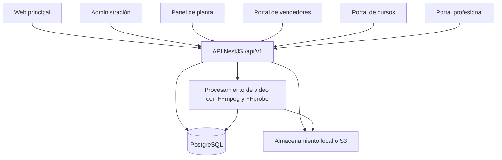

# Informe técnico integral de la plataforma Ecosistema Digital FUR

**Fecha de corte:** 12 de noviembre de 2026.

**Versión del informe:** 1.0.

**Objeto:** documentar arquitectura, funcionalidades implementadas, alcances, limitaciones y recomendaciones de evolución.

**Ámbito:** web principal, API y portales de administración, planta, vendedores, cursos y servicios profesionales.

## 1. Resumen ejecutivo

El Ecosistema Digital FUR es una plataforma web para gestionar información técnica y operaciones de plantas de beneficio de oro, relacionarlas con proveedores y profesionales, ofrecer formación y preparar/controlar presupuestos de obra mediante LULO.

La solución tiene seis aplicaciones frontend y una API común. El repositorio principal contiene la web y la API; los cinco repositorios adicionales contienen portales especializados. La persistencia se centraliza en PostgreSQL y los archivos utilizan almacenamiento local o S3 configurable.

El sistema ya dispone de flujos funcionales de catálogo técnico, activos físicos, mantenimiento, inventario, compras, documentos, cursos, comercio de productos, contratación profesional y presupuestación/ejecución/cierre LULO. Las operaciones se organizan por planta o por empresa, según el dominio.

Los principales pendientes no son únicamente visuales: faltan una gestión global de usuarios desde administración, una validación de negocio con operaciones reales de extremo a extremo, consolidación de documentación y componentes compartidos, y evidencia operativa de respaldo, recuperación, monitoreo, seguridad y capacidad para el entorno de producción elegido.

La plataforma no debe presentarse como una réplica completa de Amazon, Alibaba, Fiverr, Udemy, LuloWin, un ERP o un SCADA. Implementa flujos propios inspirados en parte de esas experiencias, con límites concretos descritos en este informe.

## 2. Método, evidencia y límites de la evaluación

El informe se basa en revisión del código fuente, rutas, esquemas, validaciones, pruebas, configuración y documentación de los seis repositorios. También recoge verificaciones de compilación y pruebas realizadas durante los cambios anteriores de esta sesión.

Se distinguen tres categorías:

- **Implementado:** existe código y una interfaz o API que permite realizar la función descrita.
- **Limitado o pendiente de validación:** existe una implementación con restricciones o falta aceptación operativa por el negocio.
- **Recomendado:** propuesta de mejora; no debe interpretarse como funcionalidad disponible.

Esta revisión no es una auditoría independiente de seguridad, una prueba de penetración, una certificación contable ni una evaluación de carga. No se inspeccionó infraestructura remota de producción ni se volvió a ejecutar toda la batería de pruebas para redactar el informe. Una guía de despliegue o un test existente no demuestran por sí solos que una función esté desplegada y aceptada en producción.

Parte de los README conserva descripciones anteriores. Cuando hay contradicciones, este informe toma como referencia la implementación y las guías específicas más recientes.

## 3. Inventario de aplicaciones y versiones de referencia

Las siguientes revisiones de `main` fueron comprobadas al iniciar el informe. La creación de este documento es posterior a esas revisiones.

| Repositorio | Responsabilidad | Puerto local | Commit de referencia |
| --- | --- | --- | --- |
| `planta_beneficio_oro` | Web principal y API compartida | Web 5173; API 3000 | `5a8aedd` |
| `planta_beneficio_oro_admin` | Administración del ecosistema | 5176 | `b84bbae` |
| `planta_beneficio_oro_panel` | Operación de planta | 5174 | `85a7bbf` |
| `planta_beneficio_oro_suppliers` | Tiendas y vendedores | 5177 | `f12ea81` |
| `planta_beneficio_oro_cursos` | Autoría y administración de cursos | 5178 | `c03d76e` |
| `planta_beneficio_oro_professional_services` | Empresas y servicios profesionales | 5179 | `e41310a` |

Los puertos son referencias de desarrollo. No constituyen direcciones de producción ni seis bases de datos independientes.

## 4. Arquitectura técnica

### 4.1 Topología

El backend es un **monolito modular**: separa responsabilidades mediante módulos NestJS, pero opera como una aplicación común. No se identificó una arquitectura de microservicios independientes para cada negocio.

### 4.2 Tecnologías observadas

| Capa | Implementación |
| --- | --- |
| Interfaces | React, TypeScript y Vite. |
| Diseño | Tailwind CSS, componentes shadcn/Radix, Lucide y componentes propios de la identidad FUR. |
| Navegación y datos | React Router y TanStack Query. |
| API | NestJS, validaciones Zod y contratos JSON bajo `/api/v1`. |
| Persistencia | PostgreSQL, Drizzle ORM, controlador `pg` y migraciones SQL. |
| Cálculos LULO | Aritmética decimal en servidor con reglas y redondeo explícitos. |
| Archivos y medios | Disco local o S3; validación de archivos según módulo. |
| Video | FFmpeg/FFprobe, trabajos persistidos en PostgreSQL y reproducción con ReactPlayer. |
| Reportes | PDFKit, ExcelJS y exportaciones CSV en módulos comerciales. |
| Pruebas | Jest/Supertest para API; Vitest/Testing Library para interfaces. |

En desarrollo se utiliza PostgreSQL embebido en el puerto 54320. La configuración admite otros destinos PostgreSQL. Existen documentos de despliegue, pero esta revisión no verifica su ejecución actual en un proveedor concreto.

### 4.3 Integración entre repositorios

Todos los portales consumen la misma API e identidad. No es necesario copiar manualmente un curso o una oferta comercial de un portal a la web principal.

La reutilización de código tiene dos mecanismos que requieren atención:

- Algunos componentes comerciales y de diseño están copiados en distintos repositorios. Un cambio de contrato puede exigir actualizaciones coordinadas.
- El panel de planta importa el código compartido de LULO desde el repositorio vecino mediante alias de Vite/TypeScript. Su compilación actual depende de disponer de esa estructura de carpetas y fuentes.

Esto funciona en el workspace actual, pero debe resolverse o documentarse de forma reproducible en CI y despliegues independientes.

## 5. Separación de datos y responsabilidades

| Dominio | Qué representa | Qué no debe confundirse con él |
| --- | --- | --- |
| Catálogo técnico común | Familias, tipos, fabricantes, modelos y variables de referencia. | Existencias comerciales de una tienda o activos instalados. |
| Activos de planta | Equipos físicos de una planta, TAG, estado, criticidad y contexto operativo. | Modelos genéricos del catálogo. |
| Inventario de planta | Existencias, almacenes, ubicaciones y movimientos internos. | Stock y reservas del marketplace. |
| Productos de vendedores | Oferta comercial, SKU, variantes, precios, fotos y stock por tienda. | Altas de modelos técnicos comunes. |
| Servicios profesionales | Ofertas, solicitudes, propuestas y trabajos por empresa. | Productos físicos o partidas LULO. |
| Cursos | Contenidos, organización oferente, instructor, inscripciones y progreso. | Etapas operativas obligatorias de una planta. |
| LULO | Maestros de costos, presupuestos, contratos, ejecución y cierre. | Catálogo comercial o contabilidad bancaria. |

Compartir clasificaciones o tipos de datos no implica mezclar registros. Las asociaciones opcionales, por ejemplo una partida LULO vinculada a un TAG, aportan contexto y no convierten automáticamente un activo en insumo ni alteran su precio.

## 6. Identidad, registro y autorización

### 6.1 Funciones implementadas

- Cuenta común para los portales del ecosistema.
- Registro con datos personales básicos y contraseña; inicio y cierre de sesión.
- Contraseñas con Argon2id, JWT de acceso y refresh token rotativo mediante cookie httpOnly.
- Tokens de acceso mantenidos en memoria por los clientes revisados, con renovación de sesión.
- Permisos por usuario, planta y rol; autorización adicional por empresa y función del equipo en los portales comerciales.
- Visibilidad de plantas pública, autenticada o privada.
- Solicitudes de acceso, aprobación/rechazo administrativo y asignación directa de miembro/rol.
- Separación entre aprobación de una empresa y su verificación comercial.

**Registrarse crea una cuenta; no crea automáticamente una solicitud de planta, no asigna un cargo y no concede privilegios operativos.** El usuario solicita acceso desde el panel de planta o un administrador lo asigna directamente.

### 6.2 Administración de accesos actual

En **Solicitudes de acceso** se revisan peticiones enviadas. El botón **Asignar acceso** permite introducir correo registrado, planta y rol sin esperar una petición. La ficha de planta tiene **Miembros y roles** y el panel operativo dispone de **Equipo**, sujetos a permisos.

No existe todavía un directorio global de todas las cuentas con una ficha administrativa unificada de plantas, empresas y roles. El rol define permisos; no hay un campo general independiente para el cargo laboral o la estructura de recursos humanos.

### 6.3 Controles y límites

La API utiliza guards, validación de entradas, CORS configurable, Helmet y correlación de solicitudes. Los límites de autenticación se configuran por entorno. Estos controles no sustituyen una evaluación completa de amenazas y configuración del despliegue.

En las rutas de autenticación revisadas no se identificó un flujo completo de recuperación de contraseña, verificación de correo ni segundo factor. Se recomienda diseñarlos y verificarlos antes de una apertura amplia a usuarios externos.

## 7. Administración del ecosistema

**Implementado:** resumen e indicadores, gestión de plantas y su visibilidad, miembros/roles, etapas y redes, solicitudes de acceso, asignación directa, aprobación/suspensión de empresas, verificación, catálogo técnico, incidencias comerciales y de servicios, y consulta de actividad.

La gestión de catálogo incluye familias, tipos, fabricantes, modelos, imágenes y variables técnicas. Las variables admiten tipos y alcances por red, etapa y tipo de activo, además de valores generales y específicos del modelo.

**Límites:** la pantalla de solicitudes no es un registro de usuarios. La matriz de permisos está principalmente definida en código y datos iniciales, no como un diseñador administrativo general. La consulta de actividad no equivale a una herramienta completa de investigación, exportación y retención de auditoría.

**Recomendación:** crear una sección **Usuarios y accesos** con búsqueda, estado, membresías por planta y empresa, historial de cambios y acciones explícitas de asignación/revocación, reutilizando los controles de autorización existentes.

## 8. Operación de planta

### 8.1 Activos físicos y ficha FUR

Permite consultar, crear, editar y dar de baja activos según permisos; relacionarlos con modelos técnicos, etapas y redes; mantener TAG, estado, ubicación, criticidad, especificaciones y documentación.

El geoportal combina listado, selección de etapa/red, mapa y ficha técnica. El mapa de planta utiliza posiciones de referencia por etapa. Esas marcas no garantizan la posición exacta de cada equipo ni una georreferenciación topográfica. El diagrama técnico conserva su propio contexto de ubicaciones.

**Mejoras:** editor controlado de posiciones por activo, calibración por planta, leyenda/agrupación de marcadores, accesibilidad y validación de uso en pantallas pequeñas. Si se requiere GIS, definir sistema de coordenadas, precisión y fuentes cartográficas antes de ampliar.

### 8.2 Procesos y redes

Las etapas y redes habilitadas organizan activos e indicadores. Las conexiones modelan flujo principal y retornos; la configuración y visibilidad se controlan por planta y permiso.

Las redes de IoT, potencia, calidad o cámaras sirven como organización de información. Su presencia en el menú o en el maestro no demuestra que existan conectores activos a PLC, SCADA, laboratorio o CCTV. No se verificaron esas integraciones industriales en este informe.

### 8.3 Mantenimiento

Incluye planes y órdenes de trabajo, cambios de estado, repuestos/costos y relación con activos y necesidades de compra. Permite seguimiento de la operación documentada.

No debe presentarse como mantenimiento predictivo automático. Para ello faltarían integración de señales, calidad de datos, reglas o modelos, evaluación de resultados y un procedimiento de actuación aprobado.

### 8.4 Inventario y compras

El inventario de planta contempla ítems, almacenes, ubicaciones y movimientos como ingresos, salidas, transferencias y ajustes. Compras incluye requisiciones, revisión/aprobación, solicitudes de cotización a proveedores, adjudicación y recepción.

El stock de tiendas es independiente. Comprar en el marketplace no debe interpretarse como ingreso automático al almacén de planta sin una integración explícita y validada. Tampoco se verificó una contabilidad general o fiscal integrada a estos movimientos.

### 8.5 Documentos

Gestión de cargas, nuevas versiones, metadatos, archivo y descargas autorizadas. La base registra referencias de almacenamiento; los bytes se guardan en el driver configurado. Algunos archivos son públicos según su finalidad, como imágenes comerciales, mientras que documentos internos y entregas requieren autorización.

**Mejoras:** clasificación documental y retención, límites por organización, detección de malware, restauración de objetos y trazabilidad de descargas cuando el negocio la requiera.

## 9. Marketplace y portal de vendedores

### 9.1 Alcance implementado

- Entrada pública unificada **Marketplace**, con productos y vendedores.
- Filtro entre tiendas verificadas y particulares no verificados; la verificación la administra el ecosistema.
- Gestión comercial desde el portal de vendedores, no desde la ficha pública.
- Productos propios con categorías, especificaciones tipadas, marca/modelo comercial, variantes, SKU, imágenes y publicación.
- Stock por variante, reservas y movimientos; restricciones para no reducir existencias por debajo de las reservas.
- Cantidades mínimas, tramos mayoristas y promociones con vigencia.
- Carrito separado por tienda, modalidad y moneda; validación de importes y stock al confirmar.
- Compra directa y solicitud de cotización, propuesta/versiones, aceptación y seguimiento.
- Transferencia bancaria informada por el comprador y confirmada manualmente por la tienda.
- Cobertura y tarifas de entrega configurables, seguimiento manual, devoluciones, reembolsos registrados y reseñas de compras entregadas.
- Conversaciones, archivos privados, avisos internos e incidencias con mediación administrativa.
- Importación estricta Excel con productos, variantes, especificaciones e imágenes separadas; análisis previo y confirmación del lote.
- Exportaciones CSV y permisos comerciales por función del equipo.

### 9.2 Límites relevantes

No hay verificación bancaria automática, cobro con tarjeta, custodia de fondos ni logística integrada con transportistas. Un reembolso se registra después de realizarlo externamente; no lo ejecuta la aplicación. Las devoluciones no reponen stock sin inspección y ajuste explícito.

Las reservas de pedidos pendientes no tienen caducidad automática. Los listados, mensajes y exportaciones tienen límites operativos documentados, por lo que no deben asumirse como consultas ilimitadas del histórico.

**Mejoras prioritarias:** vencimiento de reservas con recuperación segura, paginación completa, conciliación de transferencias, referencias inequívocas y reportes por período. Una pasarela de pago sería una ampliación opcional del negocio; no es necesaria para respetar la modalidad de transferencia elegida.

## 10. Servicios profesionales

### 10.1 Alcance implementado

El profesional registra su empresa, recibe aprobación, prepara perfil/portafolio y publica ofertas por paquete o presupuesto personalizado. La oferta contiene alcance, moneda, precio de referencia o fijo, plazo, revisiones, entregables, extras, requisitos y preguntas frecuentes.

La contratación personalizada sigue:

**Solicitud → Propuesta → Aceptación → Requisitos → Transferencia → Confirmación → Ejecución → Entrega → Aprobación.**

Existen propuestas versionadas y con vencimiento, cambios solicitados, hitos opcionales, conversación y archivos privados, ampliación de plazo, revisiones limitadas, cancelación, reembolso registrado, mediación y reseñas de trabajos completados.

El profesional trabaja en **Trabajos y solicitudes**; el cliente sigue su expediente en **Mis contrataciones**. La API impide contratar servicios propios. La ficha explica esa restricción a los miembros de la empresa y ofrece la gestión en el portal profesional.

### 10.2 Límites y mejoras

- Los hitos organizan entregas; no representan custodia ni liberación parcial automática de fondos.
- Los pagos y reembolsos requieren ejecución y comprobación externas.
- Los avisos son internos, consultados periódicamente; no equivalen a correo, SMS o notificaciones push.
- El editor de presupuesto personalizado conserva paquetes de referencia. Debe diferenciar mejor campos opcionales orientativos de las condiciones definitivas de la propuesta.
- Un paquete publicado con precio cero representa una contratación gratuita; no debe utilizarse para comunicar ambiguamente «precio por acordar».

Se recomienda una revisión completa de lenguaje, condiciones de publicación y vistas de cliente/profesional, con pruebas de aceptación realizadas con cuentas de roles diferentes.

## 11. Cursos y formación

### 11.1 Alcance implementado

Los cursos pertenecen al ecosistema, a un proveedor o a un contratista habilitado. El portal de cursos administra borradores, publicación, archivo, módulos, lecciones, objetivos, participantes, requisitos, categorías, nivel, portada e instructor.

El instructor tiene perfil propio con foto y biografía, vinculable a cursos. La web principal presenta el catálogo y la experiencia del alumno: inscripción, contenido autorizado, progreso, reanudación y certificado verificable cuando corresponde. Los cursos ya no requieren asociación a una etapa de planta.

Se admiten videos externos compatibles y archivos MP4/MOV/WebM. Los archivos se preparan con FFmpeg/FFprobe en trabajos persistidos; la salida propia es MP4 H.264/AAC hasta 1080p, con reproducción progresiva y rangos HTTP. El progreso de reproducción se guarda por alumno/lección/versión del medio.

### 11.2 Límites y mejoras

El precio de curso es informativo: no se ha implementado un checkout que condicione la inscripción al pago. No se identificó un motor de exámenes calificados, supervisión o evaluación de competencias equivalente a un LMS avanzado.

La transcodificación propia no genera una escalera multicalidad adaptativa ni DRM. El umbral de reproducción registrado no demuestra comprensión ni visionado único de todos los segmentos.

**Mejoras:** aclarar comercialmente los cursos con precio, definir evaluaciones, fortalecer evidencias de aprendizaje y desacoplar el procesamiento de video de la API cuando las mediciones de carga lo justifiquen. Preservar las autorizaciones y la invalidación de accesos al cambiar archivos.

## 12. LULO: presupuestación, ejecución y cierre

### 12.1 Maestros y presupuestación

Se recuperaron del archivo original 8.057 partidas/APU, 3.209 materiales, 672 equipos, 164 registros de mano de obra y 40 familias. La biblioteca común se conserva separada de creaciones y ajustes privados de planta.

Incluye consulta y mantenimiento de maestros propios, edición de composición/rendimiento/desperdicio, unidades y proveedores, importación Excel/CSV con validación, listas de precios por moneda/vigencia, cliente/obra, capítulos y partidas.

Los precios pueden ser calculados, manuales o asumidos. El motor aplica parámetros de FCAS, administración, utilidad, financiamiento e impuesto con cálculo decimal y redondeo definido. Permite borradores pendientes, recálculo selectivo con propuesta y vencimiento, revisión/devolución/emisión y nuevas versiones. La emisión conserva fuentes y datos de cálculo.

### 12.2 Control de obra

Un presupuesto emitido origina un contrato con línea base, plazo y condiciones. El expediente incorpora cómputos geométricos controlados, mediciones/evidencias, órdenes de cambio, precios por fecha de ejecución, valuaciones con asignaciones parciales y cronograma con pesos/dependencias.

Se controlan cantidades disponibles, doble asignación, acumulados, saldos, impuestos de partidas gravadas, anticipo desembolsado, amortización y retenciones. Los documentos autorizados se corrigen mediante referencias e historial, no sobrescribiendo el pasado.

### 12.3 Reconsideraciones y cierre

Admite índices documentados, perfiles polinómicos mensuales aprobados, alcance elegible y ajustes incrementales. Registra anticipos, devoluciones, pagos y liberaciones para conciliación.

La conciliación por corte compara cantidades, importes, saldos y fuentes. El cierre exige resolver pendientes y documentar diferencias residuales con responsable, condición y evidencia. El cierre emitido bloquea movimientos; la rectificación autorizada conserva su vínculo histórico.

### 12.4 Límites

Los precios históricos requieren confirmación de moneda, denominación, fecha y base de costo. No hay conversión automática de monedas, índices oficiales conectados, pagos bancarios ejecutados ni paridad certificada con todas las fórmulas/reportes de LuloWin 2018.

El FCAS parametrizado no sustituye nómina ni un motor laboral completo. Los presupuestos del módulo anterior se conservan, pero no migran automáticamente al nuevo contrato. La aceptación de negocio con una obra real, períodos consecutivos y cierre sigue siendo necesaria.

## 13. Reportes e indicadores

### 13.1 LULO

Dispone de 14 tipos con salida PDF/Excel: presupuesto, capítulos, APU, relación de insumos, cómputo, medición, orden de cambio, valuación, cronograma, índice, perfil de ajuste, reconsideración, movimiento de saldo y cuadro de cierre.

El cierre reúne demostrativo de cantidades, importes, conciliación, resoluciones y expediente fuente. Los anexos se relacionan mediante referencias; no se fusionan automáticamente todos los archivos en un PDF. Excel conserva decimales como texto para mantener precisión y no funciona como libro de recálculo con fórmulas.

### 13.2 Resto de la plataforma

Existen indicadores en administración, planta y portales comerciales/formativos, además de exportaciones comerciales CSV. Son métricas operativas de sus dominios, no un sistema BI consolidado de todo el ecosistema.

No se identificó un reporte gerencial único de todas las obras, una curva S exportable o un Gantt gráfico de LULO. Tampoco se debe presentar un importe documentado o confirmado manualmente como conciliación bancaria automática.

**Recomendación:** definir un catálogo de reportes con nombre, fuente, filtros, fecha de corte, moneda, permisos y criterios de conciliación. Evitar sumar monedas diferentes o mezclar pedidos, cobros confirmados y reembolsos.

## 14. Integridad, concurrencia y trazabilidad

Se utilizan claves foráneas, restricciones, validación de estados, transacciones, bloqueo de filas, revisiones e idempotencia en operaciones sensibles de comercio y LULO. Las emisiones conservan copias y referencias de origen; archivos internos versionados respaldan evidencias documentales.

Estas técnicas no implican que cada endpoint tenga idéntica garantía. Por ejemplo, la transferencia de cómputos a presupuestos requiere revisión y vista previa, pero un reintento con revisión antigua puede devolver conflicto en vez de recuperar la respuesta previa. Debe inventariarse qué escrituras son idempotentes y cómo debe reintentarlas cada cliente.

La auditoría registra eventos de operaciones implementadas, pero no debe asumirse como almacenamiento WORM, firma digital certificada ni retención regulatoria validada. Se recomienda definir integridad, acceso, conservación y restauración del registro según las necesidades del negocio.

## 15. Operación, almacenamiento y despliegue

### 15.1 Situación observada

Hay scripts para arranque local, compilación, pruebas, migraciones y preparación de datos de desarrollo. La API valida configuración de base de datos, secretos, cookies, orígenes y almacenamiento. Los archivos locales requieren persistencia; S3 es un driver disponible.

Existen guías de despliegue y referencias a servicios externos. No se verificaron recursos remotos, dominios, certificados, costos, alta disponibilidad o políticas efectivas de respaldo. No se encontraron archivos de workflow en `.github/workflows` de los seis repositorios revisados; esto no descarta automatizaciones externas no inspeccionadas.

### 15.2 Hallazgos operativos

- La ruta de salud devuelve HTTP 200 incluso si PostgreSQL está caído y comunica la degradación en el cuerpo. Un monitor que mire solo el código HTTP puede informar un estado incorrecto.
- Las cargas de video necesitan capacidad de CPU, disco temporal y límites de proxy acordes con sus tamaños.
- Varias instancias con almacenamiento local necesitan una estrategia de disco compartido o migración a almacenamiento de objetos.
- Migraciones, API y frontends deben publicarse coordinadamente por sus contratos compartidos.
- Los seeds y herramientas de recuperación/desarrollo no sustituyen un procedimiento de migración y restauración de producción.

### 15.3 Recomendación de operación

Antes de producción, establecer ambientes separados, copias de base y objetos, restauración ensayada, objetivos RPO/RTO acordados, monitoreo de disponibilidad/dependencias, centralización de logs sin secretos, gestión de incidentes y procedimiento de reversión.

Separar **liveness** de **readiness**. Definir alertas que evalúen base de datos, almacenamiento y cola de medios, además del proceso HTTP. Mantener credenciales reales fuera del repositorio y retirar cuentas/datos de demostración de los entornos públicos.

## 16. Experiencia de usuario y diseño

Los portales comparten identidad FUR, colores, tipografía, navegación, tarjetas, componentes propios, modo oscuro y adaptaciones de tamaño. La navegación pública agrupa funciones operativas y servicios; Presupuestos LULO aparece en Servicios sin perder su contexto operativo de planta.

La consistencia aún necesita revisión de recorrido completo, no solo de color. Los casos recientes de solicitudes vacías, edición de servicios y contratación propia mostraron que una función disponible puede ser difícil de descubrir o interpretar.

Se recomienda probar por separado visitante, cliente, miembro de planta, responsable de empresa y administrador. Cada pantalla debe explicar estado, siguiente acción, motivo de bloqueo y destino después de guardar. Deben revisarse teclado, foco, contraste, lector de pantalla, zoom y uso móvil mediante una evaluación específica de accesibilidad.

## 17. Calidad y evidencia de verificación

Los repositorios incluyen pruebas unitarias, de componentes y de integración contra PostgreSQL. Hay casos de aislamiento, archivos, publicación, cálculos, permisos, versiones y concurrencia.

Entre las verificaciones registradas durante esta sesión previa al informe se encuentran:

| Área | Evidencia disponible | Límite de la evidencia |
| --- | --- | --- |
| LULO | Pruebas de API/cálculo/regresión e interfaz; recorrido de presupuesto a cierre/rectificación; inspección de PDF y lectura de Excel de prueba. | Datos de prueba, no aceptación de una obra real. |
| Servicios profesionales | Nueve pruebas de integración del flujo comercial; pruebas de interfaz de contratación/cotización y guardado repetido. | No es una prueba de carga ni conciliación bancaria real. |
| Accesos administrativos | Tres pruebas de asignación directa, validación de roles y ausencia de escritura al abrir el diálogo. | No constituye un directorio global de usuarios. |
| Compilación | Compilaciones satisfactorias de API, web y los cinco portales durante el trabajo realizado. | No acredita por sí sola un despliegue productivo. |

Se observaron avisos de tamaño de bundles en compilaciones frontend. Son una señal para medir y optimizar, no una prueba automática de lentitud en todos los escenarios.

No se declara un porcentaje de cobertura, tasa de disponibilidad, tiempo de respuesta objetivo cumplido, capacidad máxima de usuarios ni número global de pruebas aprobadas para toda la plataforma en esta revisión.

## 18. Riesgos y recomendaciones priorizadas

**P0:** condición a resolver o verificar antes de producción. **P1:** siguiente ciclo de estabilización. **P2:** evolución posterior. Las prioridades son propuestas y requieren acuerdo con responsables técnicos y de negocio.

| ID | Prioridad | Hallazgo o condición | Acción recomendada | Criterio de aceptación |
| --- | --- | --- | --- | --- |
| R01 | P0 | No se aportó evidencia de restauración productiva. | Respaldar PostgreSQL y archivos; ensayar recuperación y acordar RPO/RTO. | Restauración aislada documentada, con relaciones y archivos comprobados. |
| R02 | P0 | La seguridad del código no valida la configuración pública. | Revisar secretos, cookies/CORS/proxy, permisos, cuentas de prueba y recuperación de acceso. | Pruebas por rol/organización y checklist de despliegue aprobados. |
| R03 | P0 | No hay aceptación integral de negocio para todos los dominios. | Ejecutar pilotos de planta, comercio, formación y LULO con responsables reales. | Casos, datos, resultados, incidencias y aceptación firmada internamente. |
| R04 | P0 | Salud HTTP puede ocultar dependencia caída. | Separar liveness/readiness y alertar por estado de dependencias. | Caída simulada detectada y notificada sin declarar la aplicación lista. |
| R05 | P1 | No hay sección global de usuarios. | Implementar Usuarios y accesos, búsqueda y membresías auditadas. | Ver una cuenta, sus plantas/empresas y asignar/revocar con permisos. |
| R06 | P1 | Contratos y componentes compartidos entre repositorios. | Crear paquetes compartidos o workspace reproducible y contratos versionados. | Compilar desde checkout limpio sin copias manuales ni rutas implícitas. |
| R07 | P1 | No se identificó CI en los repositorios revisados. | Automatizar instalación reproducible, análisis, pruebas y compilaciones; coordinar migraciones. | Cambios bloqueados ante fallos y artefactos/revisiones identificables. |
| R08 | P1 | Reserva comercial sin vencimiento automático. | Definir expiración, aviso, cancelación segura y recuperación de reservas. | Pruebas de vencimiento/concurrencia sin vender ni liberar unidades dos veces. |
| R09 | P1 | Pago informado y pago real dependen de validación humana. | Reforzar referencias, comprobantes, funciones financieras y conciliación. | No aceptar doble referencia sin tratamiento; historial y conciliación verificables. |
| R10 | P1 | LULO conserva precios históricos y reglas parametrizadas. | Validar moneda/vigencia, APU y perfiles con costos/obra/administración. | Presupuesto, períodos y cierre reconciliados contra casos aprobados. |
| R11 | P1 | El precio del curso no restringe inscripción por pago. | Elegir política: formación gratuita con precio orientativo o acceso comercial con checkout. | La interfaz y la autorización coinciden con la política elegida. |
| R12 | P1 | Formularios de cotización y roles pueden resultar ambiguos. | Diferenciar oferta fija/referencia, cliente/gestor y estados sin acceso. | Pruebas con usuarios nuevos completan el recorrido sin instrucciones externas. |
| R13 | P1 | Video y archivos concentran recursos y exposición. | Medir capacidad, limitar cuotas, revisar antimalware y aislar workers cuando corresponda. | Cargas simultáneas no degradan operaciones críticas y fallos son recuperables. |
| R14 | P2 | Límites de listados, consultas y exportaciones. | Paginación uniforme, índices medidos y exportaciones por período o asíncronas. | Histórico completo recuperable con límites explícitos y tiempos medidos. |
| R15 | P2 | Mapas e indicadores no son GIS/SCADA verificados. | Definir coordenadas y conectores únicamente según necesidad operativa. | Exactitud y procedencia de datos identificadas y validadas por planta. |
| R16 | P2 | Documentación y reportes no están consolidados. | Actualizar README, catálogo de reportes y matriz de capacidades por versión. | No hay instrucciones contradictorias para cursos, LULO y accesos. |

## 19. Hoja de ruta propuesta

### Fase A. Línea base y operación segura

Inventariar ambientes y datos, revisar políticas de acceso, establecer respaldo/restauración y monitoreo, documentar configuración y responsables. No agregar integraciones críticas sin estas bases.

### Fase B. Estabilización de recorridos

Completar usuarios/accesos, aclarar paquetes/cotizaciones, revisar publicación y precios de cursos, mejorar errores por campo y validar navegación entre portales. Conservar separaciones entre catálogo, productos, inventario y LULO.

### Fase C. Pilotos de negocio

Ejecutar una operación representativa por dominio: equipo/OT/repuesto/compra, producto/pedido/transferencia/entrega, servicio/propuesta/ejecución, curso/alumno/certificado y obra/presupuesto/valuaciones/cierre.

### Fase D. Industrialización técnica

Introducir CI, paquetes compartidos, pruebas de contrato entre API/portales, despliegues reproducibles, observabilidad y evaluación de rendimiento. Desacoplar trabajos pesados cuando haya evidencia de necesidad.

### Fase E. Evolución funcional

Priorizar reportes gerenciales, evaluación formativa, conectores industriales, logística o nuevas modalidades de pago según retorno y demanda. No se asignan fechas ni costos en este informe: requieren estimación, capacidad del equipo y dependencias acordadas.

## 20. Criterios mínimos para una liberación operativa

- [ ] Ambientes, versiones de API/portales y configuración identificados.
- [ ] Migraciones ensayadas sobre una copia representativa y con plan de recuperación.
- [ ] Respaldo y restauración de base y objetos comprobados.
- [ ] Sesiones, roles, membresías y descargas probados con usuarios de organizaciones distintas.
- [ ] Política de pagos manuales y responsabilidades financieras comunicada.
- [ ] Precios y reglas LULO validados por negocio.
- [ ] Publicación, aprendizaje y certificados LMS comprobados; política comercial del curso definida.
- [ ] Inventario, reservas, compras y devoluciones conciliados en sus dominios.
- [ ] Pruebas y compilaciones del conjunto que se libera ejecutadas con resultados conservados.
- [ ] Monitoreo, alertas y procedimiento de incidentes disponibles.
- [ ] Documentación del usuario coherente con la versión publicada.
- [ ] Responsables de cada proceso aceptan sus casos piloto y límites.

## 21. Fuentes técnicas y documentación de apoyo

Las rutas relativas siguientes permiten revisar la evidencia desde esta carpeta del repositorio principal:

- [Módulos de la API](../apps/api/src/app.module.ts), [configuración HTTP](../apps/api/src/app.setup.ts) y [validación de entorno](../apps/api/src/config/env.ts).
- [Autenticación](../apps/api/src/modules/iam/auth.controller.ts), [registro y sesiones](../apps/api/src/modules/iam/auth.service.ts) y [catálogo de permisos](../apps/api/src/modules/iam/permissions.catalog.ts).
- [Asignación y solicitudes en administración](../../planta_beneficio_oro_admin/src/pages/access-requests-page.tsx) y [miembros de planta](../../planta_beneficio_oro_admin/src/pages/plant-detail-page.tsx).
- [Solicitud de acceso desde planta](../../planta_beneficio_oro_panel/src/pages/access-request-page.tsx).
- [Almacenamiento](../apps/api/src/modules/documents/storage.service.ts) y [salud de la API](../apps/api/src/modules/health/health.controller.ts).
- [Guía de tiendas y marketplace](SHOP_COMMERCE.md) y [guía de servicios profesionales](PROFESSIONAL_SERVICES.md).
- [Autoría LMS](LMS_AUTHORING.md), [video LMS](LMS_VIDEO.md) y [reglas de publicación](../apps/api/src/modules/lms/course-publication.ts).
- [LULO: tres etapas](LULO_TRES_ETAPAS.md), [guía de usuario de principio a fin](GUIA_USUARIO_LULO_PRINCIPIO_A_FIN.md) y [recuperación de maestros](LULO_RECUPERACION_MAESTROS.md).
- [Reportes de presupuesto](../apps/api/src/modules/budget/lulo-reports.ts) y [reportes de obra y cierre](../apps/api/src/modules/budget/lulo-works.reports.ts).
- [Integración compartida de LULO en el panel de planta](../../planta_beneficio_oro_panel/vite.config.ts).

Las recomendaciones de este documento no modifican la aplicación ni implican que ya se hayan ejecutado. Su implementación debe registrarse y verificarse en entregas posteriores.
