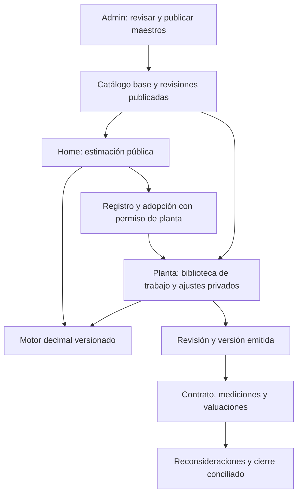

# Plan de ejecución: Presupuestos LULO integrado al ecosistema FUR

Fecha de evaluación: 11 de noviembre de 2026.

**Corrección de ubicación y alcance aplicada:** los maestros convertidos se consultan desde el home y se trabajan desde el panel de planta 5174. Admin dejó de ser la entrada operativa. Véase [Maestros originales en planta](LULO_MAESTROS_EN_PLANTA.md) para el resultado vigente; las referencias siguientes a revisión administrativa describen el diseño anterior.

Estado inicial: evaluación y propuesta de ejecución. Tras recibir `LULO.MDB` se implementaron la recuperación, corrección y aprobación auditadas en Admin y versiones internas de referencia, documentadas en [Recuperación y revisión de maestros](LULO_RECUPERACION_MAESTROS.md). La implementación operativa inicial de L2/L3/L4 ya conecta cálculo decimal, catálogo activable, estimación pública, adopción en planta, revisión/emisión, sucesión de versiones y cuatro reportes PDF/Excel; véase [LULO operativo](LULO_OPERATIVO.md). Las tarifas reales del MDB requieren verificación económica antes de activarse. Control de obra, reconsideraciones/cierre y equivalencia ampliada conservan el alcance posterior L5/L6/L7; este documento no declara equivalencia completa con LuloWin 2018.

## 1. Decisión de arquitectura

Construir **un dominio de presupuestación, un catálogo base compartido y un motor de cálculo versionado**, con dos experiencias:

- **Pública, desde el home:** consultar las partidas y precios autorizados para publicación, analizar sus componentes y preparar una estimación sin registrarse.
- **Privada, dentro de una planta:** preparar obras, presupuestos y APU propios, revisar, emitir, controlar ejecución y cerrar con permisos y trazabilidad.

Se recomienda ampliar NestJS, PostgreSQL/Drizzle y React existentes. El prototipo Hono/React anterior se utiliza como fuente de maestros y referencia de interacción, sin desplegar otro backend, otra identidad ni otra base de clientes. El motor Python entregado sirve como referencia de comparación para el perfil documentado, no como segundo servicio de cálculo productivo.

**Supuestos de producto propuestos para iniciar:** el visitante puede elaborar una estimación útil y exportarla como preliminar sin registro; la persistencia compartida, la asociación a una planta y la emisión formal requieren identidad y permisos. Estos límites deben quedar explícitos antes de construir la experiencia pública. Registro de usuario y pertenencia a una planta son condiciones diferentes.

## 2. Lo que existe y lo que debe cambiar

### Base actual del ecosistema

El esquema `budget` ya contiene recursos, historial de precios, tipos de cambio, APU, composición, proyectos, presupuestos, capítulos, partidas, escenarios y valuaciones. El controlador está restringido a `plants/:plantId/budgets`, con `budget.read`, `budget.edit` y `budget.approve`.

Hay funcionalidades comprobables: cálculo de APU, búsqueda y edición, importación de costo de inventario, presupuestos con capítulos, aprobación con bloqueo de cambios, duplicación, escenarios, comparación de precios y valuaciones acumuladas con límite de cantidades. En esta revisión pasaron **74 pruebas** de `budget-engine.spec.ts` y `budget.e2e.spec.ts`. Son evidencia de las reglas actuales, no de paridad con el legado.

| Área | Situación comprobada | Trabajo requerido |
| --- | --- | --- |
| Acceso público | La ruta web requiere autenticación y planta; el menú bloquea LULO a visitantes. | Entrada pública propia, permiso público explícito y datos filtrados por publicación. |
| Catálogo | Recursos y APU pertenecen obligatoriamente a una planta. | Catálogo publicado global, revisiones y ajustes privados por planta. |
| Motor | Usa `number`; tarifa horaria por jornada/rendimiento, redondeo intermedio a cuatro decimales; generales y utilidad sobre costo directo. | Precisión decimal, bases de costo explícitas y perfiles de cálculo identificados. |
| Histórico | Aprobación congela PU y desglose agregado por cuatro tipos. | Copia completa de composición, costos, moneda, cambio, parámetros, contraparte y reglas. |
| Borradores | Los precios se consultan en vivo al leer el presupuesto. | Fijar precios por revisión del borrador y actualizar mediante recálculo explícito. |
| Precio de partida | El renglón exige `apuId`; no tiene modos manual/asumido. | Partidas calculadas, manuales y asumidas, con motivo y trazabilidad. |
| Revisión | Estados `DRAFT`, `APPROVED`, `CLOSED`; duplicación sin cadena formal de versiones. | Revisión técnica, envío/devolución, emisión y línea base contractual. |
| Control | Hay valuaciones básicas, sin el ciclo completo de mediciones/variaciones/contrato. | Etapa de control de obra apoyada en documentos aprobados. |
| Desviaciones | Se compara precio aprobado con precio maestro vigente. | Mantener esa comparación y distinguirla de costo real, ejecución y reconsideración contractual. |
| Cierre | `close()` cambia el estado de aprobado a cerrado. | Conciliación documental, corte, cantidades, saldos y expediente emitido. |
| Reportes | No existe en el controlador actual el centro de reportes descrito en los documentos. | Reportes por versión con el mismo proveedor de datos que calcula la pantalla. |

### Fuentes recibidas

La carpeta de referencia contiene manual PDF de **755 páginas**, especificación MVP, motor Python, ejemplo, guías de tres etapas, fichas ampliadas, matriz de **146 registros** y catálogo de **45 reportes**. La matriz distingue 101 funciones/variantes/investigaciones y 45 reportes. Un registro inventariado no demuestra que su comportamiento esté verificado.

El manual corresponde a 2012 y la especificación se propone contrastar con el paquete 2018. En las rutas inspeccionadas no se localizaron `LULO.mdb`, `MenuRep.xml` original ni el instalador operativo citado en las fichas. Los JSON extraídos son útiles, pero no sustituyen la validación de esas fuentes y de sus resultados.

Algunos enlaces de las guías apuntan a una subcarpeta `equivalencia/`, mientras los documentos entregados están juntos. Normalizar el paquete documental y sus enlaces en la primera entrega. Las instrucciones de arquitectura sugeridas en las guías se adaptan al stack real del ecosistema.

### Maestros y datos del prototipo

Conteo sobre los archivos de `C:/Users/username/demos_2026/lulo/lolo-backend/seeders`, sin cargar su base de datos:

| Archivo / conjunto | Registros | Interpretación |
| --- | ---: | --- |
| Familias | 40 | No hay duplicados en la clave compuesta tipo + código. Un mismo código entre tipos no es por sí solo un error. |
| Materiales | 3.209 | Fechas de actualización declaradas entre 2006 y 2026; requieren revisión de vigencia y moneda. |
| Equipos | 672 | Cuatro precios maestros en cero; unidad declarada `Hr`. |
| Mano de obra | 164 | Unidad declarada `Hr`; fechas de actualización declaradas de 2014 y 2015. |
| Partidas | 8.057 | Códigos únicos en este archivo. |
| APU | 8.062 | Asociados a diez proyectos fuente; hay códigos repetidos entre proyectos, sin duplicados proyecto + código. |
| Composición de APU | 93.541 | 27.434 renglones de materiales, 36.058 de equipos y 30.049 de mano de obra. |
| Proyectos fuente | 13 | No convertirlos automáticamente en obras privadas o públicas de FUR. |
| Paquetes de presupuesto | 4 | Datos fuente para investigar y conciliar, no presupuestos nuevos aprobados. |
| Mediciones / valuaciones en seed | 0 / 0 | No existe evidencia cargada con la que validar esos ciclos del prototipo. |

Auditoría preliminar: no se detectaron referencias de familias ni de insumos huérfanas en los conjuntos comprobados; todas las partidas tienen algún APU con su código. Se encontraron **10 renglones de composición con cantidad no positiva**. La moneda de los proyectos está expresada como objeto con símbolo `Bs.`, con textos que incluyen caracteres dañados; no identifica de forma suficiente la denominación monetaria y su fecha. La ausencia de relaciones huérfanas no prueba corrección económica.

No sumar `lulo_seed.json` a sus extractos como si fueran conjuntos independientes: comprobar si es un contenedor de los mismos datos antes de diseñar la importación.

### Reglas del prototipo que no deben trasladarse directamente

1. El recálculo de un APU actualiza también la partida maestra por coincidencia de código. En FUR, ajustar un trabajo privado nunca debe cambiar el catálogo compartido.
2. El cierre usa la cantidad final como ejecutada cuando falta la valuación, y considera ejecutadas todas las partidas extra. En el producto integrado, la ausencia de evidencia significa **pendiente o desconocido**, no ejecución completa.
3. Las rutas inspeccionadas comprueban sesión, pero varias consultas por ID no aplican pertenencia de compañía/obra. Reutilizar los permisos de planta del ecosistema y comprobarlos también en reportes, descargas y relaciones entre documentos.
4. El importador antiguo convierte valores inválidos a cero y usa conflictos ignorados. El importador integrado debe informar errores y reconciliar conteos; no aceptar pérdidas silenciosas.

## 3. Un catálogo compartido, con precios y trabajos privados protegidos

Interpretación recomendada de “el mismo catálogo”: ambas entradas consultan **las mismas identidades y revisiones publicadas de insumos y partidas presupuestarias**. Se debe confirmar la selección inicial de maestros publicables; no publicar automáticamente todos los precios, proyectos o contrapartes históricos.

El catálogo técnico de equipos/activos tiene otra función. El TAG identifica dónde se ejecutará el trabajo; el insumo de presupuesto identifica qué se consume o utiliza. Relacionarlos por ID cuando corresponda, sin convertir equipos físicos, productos de tiendas y partidas de obra en una única tabla.

### Modelo recomendado, sujeto al diseño de migración

- Añadir al dominio `budget` catálogos, publicaciones/revisiones, unidades, familias, insumos globales, precios con vigencia/fuente/base de costo y partidas/APU versionadas.
- Conservar los recursos y APU privados existentes. Añadir enlaces opcionales a la revisión global de origen y soportar registros propios sin origen global.
- Ofrecer una biblioteca que resuelva base compartida + ajustes privados autorizados. No copiar todo el maestro en cada planta. Materializar una copia de trabajo solo cuando el flujo o las relaciones existentes lo necesiten, conservando la procedencia.
- Separar definición técnica, composición y precio. Un precio es una observación con moneda, denominación, fecha, unidad/base, fuente y estado; no un atributo atemporal que se sobrescribe.
- Guardar una copia por revisión de presupuesto de cada renglón, sus insumos y precios, incluso durante el borrador. Cambiar el maestro no recalcula por sí solo un documento.
- Añadir cliente de la obra y datos de compañía emisora al presupuesto; proveedor de insumo y vendedor comercial son relaciones opcionales, no equivalencias automáticas.
- Las versiones emitidas incluyen moneda, cambio, perfil de cálculo y datos de impresión. No consultar la configuración actual de planta para reinterpretar una emisión histórica.

**Regla de aislamiento:** solo administración autorizada publica cambios del catálogo base. Ni un visitante ni una planta editan ese catálogo desde su presupuesto. Un ajuste privado se puede proponer como candidato, pero no publicarse automáticamente.

## 4. Dos accesos, un mismo producto

### Entrada desde el home

Propuesta de ruta global `/budgets`, fuera de `RequireAuth` y `PlantRoute`. La ruta privada `/plants/:plantSlug/budgets` continúa. El acceso de LULO mantiene su nombre en la navegación y usa un destino público cuando no se ha seleccionado una planta. Revisar explícitamente `NAV_ITEMS`, `navTarget`, el bloqueo de `main-navbar` y los accesos visuales del home; registrar una excepción para LULO sin desbloquear los demás módulos privados.

El visitante podrá:

1. Buscar insumos y partidas del catálogo publicado por tipo, código, descripción, familia y unidad.
2. Ver APU, rendimiento, base del costo, fecha y fuente del precio compartido.
3. Armar capítulos, añadir partidas, cambiar cantidades y preparar alternativas propias de la estimación.
4. Consultar desglose y totales calculados por el servidor, con avisos de precios históricos, pendientes o desactualizados.
5. Exportar un presupuesto preliminar con sus supuestos. Los cambios locales de precio son de esa estimación, no del catálogo.

Propuesta inicial de persistencia: guardar borrador en el dispositivo, con recuperación y opción de borrar; los servicios de cálculo no deben convertir cada visita en un proyecto persistido. Evitar enviar información de cliente innecesaria al calcular. Establecer límites de renglones, cargas, frecuencia, tamaño y exportaciones antes de publicar el servicio. No cargar los 93.541 renglones en el navegador para hacer una búsqueda: paginación y filtros en servidor.

Tras registro, conservar el borrador. Para adoptarlo en una planta, comprobar membresía y `budget.edit`, elegir planta/obra, validar de nuevo datos y versiones y mostrar diferencias de precio antes de confirmar. Si el usuario no pertenece a una planta, puede seguir con su estimación; registrarse no le da acceso a datos internos ni habilita emisión formal. El espacio persistente personal sería una ampliación de alcance, no una planta ficticia.

### Entrada desde planta

Reutilizar el editor y las piezas de interfaz del modo público, habilitando herramientas según permisos reales: biblioteca privada, precios negociados, proyectos/clientes, referencias a activos/TAG, revisión, emisión, ejecución y documentos.

El diseño debe seguir los componentes FUR existentes. Distribución recomendada: búsqueda/biblioteca contextual, área principal de capítulos y renglones y panel de desglose/totales; versiones y estado siempre visibles. No duplicar una aplicación con otra navegación o tema. El visitante debe reconocer el mismo editor cuando adopte su estimación dentro de la planta.

## 5. Contrato económico antes de migrar

### Perfiles y precisión

El algoritmo actual y el entregado no son intercambiables. Ejemplo ilustrativo sin impuesto: con directo 100, administración 10 % y utilidad 10 %, la regla actual da 120 al aplicar ambos recargos sobre directo; la regla MVP documentada da 121 porque utilidad se aplica sobre directo + administración. Ninguno debe cambiarse en silencio bajo un documento existente.

- Preservar las reglas actuales con un identificador de compatibilidad, propuesto `FUR_LEGACY_HOURLY_V1`.
- Implementar `LULO_MVP_V1` conforme al contrato documentado y contrastarlo con el motor Python.
- Reservar un perfil de equivalencia 2018 para cuando exista evidencia del original; no denominarlo compatible por haber pasado pruebas propias.
- Usar una única biblioteca decimal en el servidor, JSON con decimales como cadenas y precisión/redondeo por perfil. El frontend formatea, pero no decide importes oficiales.
- Guardar base de costo explícita: unidad de material, hora, equipo-día, persona-día, adquisición/depreciación u otra base admitida. No multiplicar por ocho un precio `Hr` sin verificar qué representa en origen.
- FCAS, bonos, costos indirectos, financiamiento, impuesto y bases aplicables deben estar parametrizados y versionados. Las tasas del ejemplo son ficticias, no parámetros fiscales de producción.
- Los seis modos de impuesto y variantes de equipo/mano de obra de las fichas se implementan y habilitan por perfiles conciliados, no como opciones que apuntan al mismo cálculo.
- No usar tasas actuales ni asumir una conversión entre denominaciones de bolívares para “actualizar” automáticamente el seed.

### Precio y recálculo

Soportar `CALCULADO`, `ASUMIDO` y `MANUAL`. El asumido conserva APU, precio calculado, precio adoptado y motivo. El manual conserva cantidad, unidad y precio sin exigir un APU ficticio.

Un recálculo selecciona alcance, clases de insumo, vigencia y parámetros; genera una vista previa con valores antes/después; confirma con revisión esperada y huella de entrada. Rechazar confirmaciones obsoletas. Mantener los precios asumidos salvo retiro explícito. Las versiones emitidas no se recalculan: se crea una sucesora enlazada.

### Pruebas patrón

El ejemplo recibido produce PU **137,94**, subtotal **3.948,50**, impuesto ilustrativo **631,76** y total **4.580,26** con el motor Python ejecutado en esta revisión. Usarlo como prueba del perfil MVP, no como comprobación de LuloWin 2018.

Añadir casos por componente, jornadas y unidades, horas/días, desperdicio, FCAS, bases de utilidad/impuesto, cantidades fraccionarias, monedas, límites y redondeos. Comparar por componente y renglón, además del total. Cada diferencia debe tener explicación y aceptación documentada.

## 6. Plan de ejecución y puertas de salida

El orden expresa dependencias. No se asignan fechas de producción hasta completar el piloto de datos y reglas.

| Entrega | Construcción | Resultado verificable para avanzar |
| --- | --- | --- |
| **L0. Base de aceptación** | Normalizar documentación; mapa de 146 fichas; clasificar maestros públicos/privados; fijar casos, bases de costo, monedas, perfiles y responsables. Inventariar las fuentes originales disponibles. | Una obra piloto y casos patrón con entradas, componentes y resultados esperados; cada regla pendiente identificada. |
| **L1. Catálogo e importación** | Tablas globales versionadas, vínculos privados y administración de maestros. Importador estricto en staging con informe y publicación separada. | Conteos conciliados; claves compuestas correctas; sin huérfanos; errores en cuarentena; ningún proyecto de origen publicado o asignado por defecto. |
| **L2. Motor común e históricos** | Motor decimal, perfiles, adaptadores de unidad, precios por vigencia, modos de precio, copias completas y revisión esperada. | Web/API/Python coinciden en casos MVP; documentos anteriores conservan sus resultados; misma entrada/versiones da el mismo resultado. |
| **L3. Experiencia pública** | Entrada del home, búsqueda paginada, editor compartido de estimaciones, guardado local y exportación preliminar. Endpoints públicos específicos. | Un visitante prepara y exporta una estimación sin sesión; no puede leer costos privados ni escribir maestros. Flujos accesibles en móvil y con teclado. |
| **L4. Presupuestación formal en planta** | Adopción del borrador público, cliente/obra, capítulos y subcapítulos, partidas propias, precios privados, recálculo selectivo, revisión/devolución/emisión y sucesión de versiones. Reportes básicos. | Presupuesto piloto emitido, reproducible e inmutable, con APU/manual/asumido y reportes conciliados. Esta es la primera entrega operativa completa de presupuestación. |
| **L5. Control de obra** | Línea base contractual, modificaciones aprobadas, cómputos, mediciones, memorias, valuaciones por período, anticipos/retenciones y cronograma. | Dos períodos consecutivos conciliados. Aprobaciones no duplican cantidades; no se cobra ni mide dos veces la misma evidencia. |
| **L6. Reconsideraciones y cierre** | Índices y variación directa según contrato; ajustes separados; conciliación por corte; cierre y rectificaciones documentadas. | Original + variaciones, cantidades medidas/valuadas, reajustes y saldos reconciliados. Ningún dato faltante se interpreta como ejecución o pago. |
| **L7. Equivalencia ampliada** | Completar reportes especiales, variantes fiscales/laborales/de equipo, funciones administrativas y capacidades de LuloCronNG inventariadas. Adaptadores de intercambio requeridos. | Matriz completa con evidencia por ficha o equivalencia web aprobada; ningún reporte o función se declara completo por tener solo una pantalla. |

L7 se trabaja transversalmente: el inventario y las pruebas se preparan desde L0, y los reportes se entregan con el dominio que los alimenta. El piloto L4 no equivale a haber terminado las 146 fichas.

### Importación estricta de L1

1. Inventariar archivos, origen, versión y hashes; preservar originales.
2. Cargar en staging, con IDs y códigos originales, sin ejecutar el seed antiguo sobre producción.
3. Validar tipos y decimales, unidades, duplicados por ámbito, relaciones, caracteres dañados, monedas/denominaciones y vigencias. Verificar muestras con el origen antes de corregir texto automáticamente.
4. Clasificar las 10 cantidades no positivas y los cuatro precios maestros de equipo en cero. No reemplazar por cero ni descartar silenciosamente renglones. Un cero justificable es una regla explícita, no un valor por defecto.
5. Resolver los 8.062 APU contextuales frente a 8.057 códigos maestros. Elegir qué composición se publica como plantilla; conservar las variantes y su procedencia sin importar obras privadas como maestros globales.
6. Presentar vista previa con aceptados, rechazados y advertencias. Confirmación idempotente, con huella de los datos y revisión esperada.
7. Validar el lote y publicar una revisión del catálogo. Usar lotes controlados para cargas grandes y una publicación atómica; una carga parcial nunca debe convertirse en catálogo público incompleto.
8. Entregar conciliación de origen/destino, informe de incidencias y mecanismo de retirar la publicación. Referencias de documentos existentes conservan la revisión usada.

### Revisión y emisión de L4

Transición propuesta de la versión: `DRAFT → IN_REVIEW → ISSUED`; devolución con motivo a borrador y nueva revisión técnica. Mantener separado el número visible de versión del contador de concurrencia. La aprobación contractual y el cierre de la obra son estados/documentos distintos de la emisión del presupuesto.

Compatibilizar los estados anteriores mediante una migración explícita y un adaptador; no renombrar automáticamente `APPROVED` a una supuesta aprobación contractual. Preservar originales y evidencias; si falta información para reconstruir un histórico, marcar esa limitación en vez de inventarla.

### Control y cierre de L5/L6

- Separar presupuesto original, aumentos, disminuciones y obras extra; los documentos aprobados determinan el alcance contractual vigente.
- Mediciones con dimensiones/factores y fuente; distinguir mediciones y valuaciones directas según lo documentado, con conciliación para no duplicar ejecución.
- Cada valuación conserva su período, cantidades, precios y acumulados. Validar vigencias y límites contra el contrato y sus variaciones aprobadas.
- Cronograma con calendario, precedencias, secciones y distribución de cantidades/recursos. No inferir un límite funcional de 104 períodos solo por las columnas del legado.
- Reconsideraciones por método contractual aprobado, con índices, revisiones y elegibilidad trazables; evitar aplicar dos veces el mismo ajuste.
- Separar ejecutado, valuado, facturado y pagado. No considerar una valuación aprobada como transferencia bancaria confirmada.
- Cierre con corte, diferencias resueltas, saldos identificados, responsable y condición de liquidación; rectificación mediante documento sucesor.

## 7. Integración con los módulos existentes

| Módulo | Integración propuesta | Límite de responsabilidad |
| --- | --- | --- |
| Identidad y permisos | Misma cuenta FUR; `budget.read/edit/approve` y permisos específicos de administración del catálogo y emisión. | Estar registrado no concede acceso a una planta. Revisar por acción, documento, reporte y archivo. |
| Administración | Gestión global de unidades, familias, insumos, partidas, publicaciones y lotes de importación. | Solo lo publicado y clasificado como público se sirve a visitantes. |
| Catálogo técnico / activos | Referencia opcional al modelo y al TAG; etapa y red como contexto. | Un activo no es automáticamente un insumo o una partida; seleccionar TAG no altera el precio. |
| Inventario | Referencia al ítem y captura explícita de su costo y unidad como fuente privada. | Un presupuesto no descuenta existencias ni cambia el costo promedio. |
| Compras / marketplace | Referencia a una cotización/oferta con precio, moneda, unidad y vigencia; incorporación mediante vista previa. | El vendedor no modifica el catálogo LULO. Cotizar no crea ni confirma un pedido. |
| Servicios profesionales | Un servicio cotizado puede originar una partida manual/subcontrato con referencia al expediente autorizado. | Aceptar una propuesta comercial no aprueba un presupuesto de planta ni implica un pago. |
| Mantenimiento | Vincular una intervención u orden a su alcance presupuestado y comparar costos reales cuando exista fuente comprobable. | La desviación de precios actual no se presenta como costo real de mantenimiento. |
| Documentos y almacenamiento | Usar el servicio existente para anexos, reportes por versión y evidencias. | Archivos y trabajos de exportación respetan el ámbito privado del solicitante. |
| Auditoría | Misma infraestructura de eventos, con lote, actor, planta, versión, causa y huella de cálculo. | No registrar información personal o financiera innecesaria en consultas públicas. |

## 8. API y componentes propuestos

Conservar `BudgetModule` y extraer servicios reutilizables de catálogo, resolución de precios, cálculo, versiones, reportes e importaciones. No hacer público el `BudgetController` de planta.

Rutas orientativas para el diseño del contrato:

- `/budget-catalog/releases`, `/budget-catalog/resources` y `/budget-catalog/apus`: únicamente publicaciones y campos públicos.
- `/budget-estimates/calculate` y `/budget-estimates/export`: simulación validada, límites y salida preliminar; sin escritura en datos de planta.
- `/admin/budget-catalog/imports/{id}/preview` y `/commit`, junto con publicación de catálogos: administración autenticada.
- `/plants/:plantId/budgets`: preservar compatibilidad y ampliar con adopción, revisiones, recálculo/confirmación, revisión/emisión y reportes.
- Rutas de contratos, mediciones, modificaciones, valuaciones, reconsideraciones y cierres: privadas y habilitadas con sus entregas.

El catálogo identifica origen y revisión, no solo un UUID enviado por el cliente. El servidor resuelve a qué publicación o dato privado puede acceder el actor. Los montos de adopción y emisión se recalculan/validan en servidor; nunca se aceptan como oficiales los totales que envía el navegador.

La exposición anónima debe ser explícita en los endpoints nuevos y considerar `ACCESS_MODE`: el requisito público de LULO no debe desaparecer por heredar un guard de planta ni abrir otras rutas. Las listas públicas tienen proyecciones propias; quitar una columna en el frontend no protege la API.

Reutilizar `features/budget`, los editores y componentes `components/budget`, y extraer una capa de presentación independiente del contexto de planta. La interfaz recibe capacidades del ámbito público/privado y conserva los estilos compartidos con web, Admin y Planta. Las pruebas existentes deben mantenerse, adaptando únicamente los cambios deliberados de contrato.

## 9. Reportes y equivalencia

En la primera entrega operativa: presupuesto estándar, presupuesto por capítulos, hoja de APU y relación de insumos. Cada salida identifica documento, versión, fecha base, moneda, perfil y parámetros. PDF/impresión y Excel deben coincidir en cantidades, alcance y totales, no solo en apariencia.

Después: comparativos, mediciones, memorias, valuaciones y carátulas, variaciones, cronograma/recursos, reconsideraciones y cierre, junto con sus dominios. Mantener un backlog explícito de las **45 opciones de reporte** y sus variantes, sin asumir que una plantilla genérica cubre todos los identificadores.

Importación/exportación web portable, Excel y compatibilidad con Access son capacidades diferentes. La compatibilidad MDB o exportación a versiones anteriores requiere adaptador, archivos originales y pruebas de reapertura. Una exportación JSON no acredita esa compatibilidad.

## 10. Validación y despliegue sin alterar históricos

1. Mantener pruebas del perfil actual como barrera de regresión.
2. Comparar el motor nuevo con entradas completas, decimales exactos y resultados patrón; contrastar la equivalencia 2018 cuando se disponga de las referencias necesarias.
3. Probar aislamiento entre dos plantas y un visitante, IDs ajenos, catálogo privado, reportes, descargas y adopción sin membresía.
4. Probar que publicar un precio no cambia documentos copiados/emitidos; un ajuste privado no cambia la publicación ni otra planta.
5. Probar recálculo concurrente, revisión obsoleta, doble emisión/adopción, duplicación y reintentos de importación.
6. Conciliar pantalla/API/PDF/Excel por componente, renglón y capítulo. Probar decimales locales, unidades, texto largo y paginación de salida.
7. Probar cargas reales del catálogo, paginación, búsqueda e importación por lotes, sin descargar toda la base al cliente.
8. Ejecutar migraciones aditivas primero en pruebas. Conservar respaldo y un mapa verificable de registros anteriores; habilitar el catálogo y el modo público mediante banderas controladas.
9. Pilotar con una planta y un conjunto pequeño conciliado. Ampliar el catálogo solo tras validar la calidad económica y las reglas, no solo porque el importador termine sin errores.
10. Mantener dos estados de evidencia: “funcionalidad web comprobada” y “equivalencia con legado comprobada/aprobada”. Los pendientes del segundo grupo no se ocultan como terminados.

## 11. Paquete de trabajo inicial listo para ejecutar

La primera intervención recomendada es **L0 + un piloto de L1/L2**, no un cambio de colores ni una importación masiva:

- Informe de calidad de maestros reproducible, con la clasificación de anomalías encontrada aquí.
- Diccionario de unidades, bases de costo y monedas, con mapeo de códigos originales y vigencias.
- Diseño de tablas y contratos revisado contra los FK y permisos actuales.
- Un catálogo de prueba pequeño, publicado de forma controlada, con material/equipo/mano de obra y sus partidas.
- Dos perfiles identificados: compatibilidad actual y MVP documentado, sin cambiar históricos.
- Casos patrón y una demostración técnica de que la misma revisión puede calcularse desde el modo público y una planta con resultado idéntico, antes de aplicar ajustes privados.
- Criterios cerrados de la experiencia anónima, adopción y emisión, y una obra piloto con quien prepara y quien revisa claramente identificados.

La primera entrega pública de estimación será L3, una vez validados catálogo y motor; la primera entrega privada de presupuestación formal será L4. Control de obra y cierre son entregas funcionales posteriores del mismo plan; no se presentarán como existentes por reutilizar la palabra “cerrar” de la pantalla actual.

## Fuentes y evidencia de esta evaluación

- [Manual de usuario, referencia histórica](../apps/web/public/lulo_replica_web/Manual%20de%20Usuario.pdf). PDF de 755 páginas; referencias impresas = posición PDF menos uno. Se contrastaron las secciones de insumos, partidas y presupuesto con/sin APU, y el índice del ciclo de control y reportes. No se realizó una validación interactiva del programa original.
- [Índice de implementación](../apps/web/public/lulo_replica_web/INDICE_IMPLEMENTACION_LULO_WEB.md), [equivalencia 2018](../apps/web/public/lulo_replica_web/ESPECIFICACION_EQUIVALENCIA_LULOWIN_NG_2018.md), [MVP](../apps/web/public/lulo_replica_web/ESPECIFICACION_MVP.md), [etapa 1](../apps/web/public/lulo_replica_web/ETAPA_01_PRESUPUESTACION.md), [etapa 2](../apps/web/public/lulo_replica_web/ETAPA_02_CONTROL_DE_OBRA.md) y [etapa 3](../apps/web/public/lulo_replica_web/ETAPA_03_RECONSIDERACIONES_Y_CIERRE.md).
- [Conciliación pendiente](../apps/web/public/lulo_replica_web/05_CONCILIACION_BASE_Y_PENDIENTES_2018.md), [reportes](../apps/web/public/lulo_replica_web/04_REPORTES.md), [matriz](../apps/web/public/lulo_replica_web/matriz_equivalencia.json) y [parámetros de reportes](../apps/web/public/lulo_replica_web/reportes_2018.json).
- [Motor de referencia](../apps/web/public/lulo_replica_web/motor_presupuesto.py) y [caso de demostración](../apps/web/public/lulo_replica_web/ejemplo_presupuesto.json), ejecutado con total esperado 4580.26.
- [Modelo de datos actual](../apps/api/src/database/schema/budget.ts), [motor actual](../apps/api/src/modules/budget/budget-engine.ts), [resolución de precios](../apps/api/src/modules/budget/pricing.service.ts), [presupuestos](../apps/api/src/modules/budget/budgets.service.ts), [valuaciones](../apps/api/src/modules/budget/valuations.service.ts) y [controlador](../apps/api/src/modules/budget/budget.controller.ts).
- [Pruebas de integración actuales](../apps/api/test/budget.e2e.spec.ts), [pruebas del motor](../apps/api/src/modules/budget/budget-engine.spec.ts) y rutas/componentes de `apps/web/src/features/budget`, `pages` y `components/budget`.
- Prototipo: `C:/Users/username/demos_2026/lulo/lolo-backend/src/db/schema.ts`, `src/db/seed.ts`, `src/routes/apu.ts`, `src/routes/cierre.ts` y extractos de `seeders`. Conteos y relaciones inspeccionados directamente; no se ejecutó el seed ni se migraron sus proyectos.

La evaluación de datos es preliminar y reproducible por conteos/relaciones; no certifica actualización de precios ni equivalencia económica. Los documentos originales de referencia se mantienen como fuentes de trabajo y no deben convertirse automáticamente en descargas públicas del producto.
